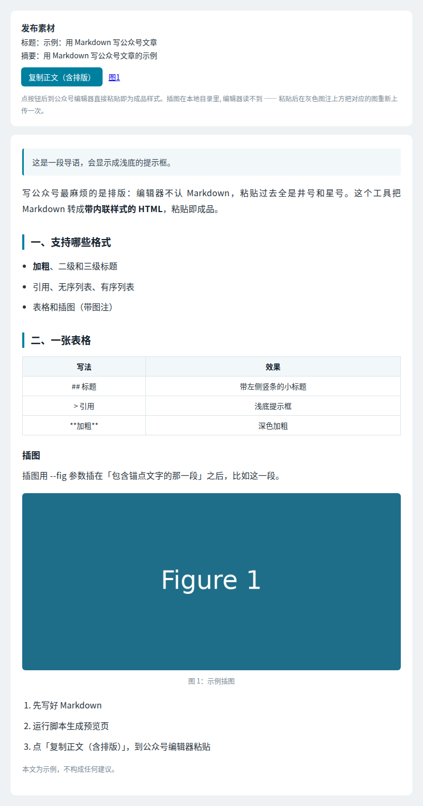

# wechat-mp-format

把 Markdown 文章转成**微信公众号编辑器能直接粘贴**的排版。单文件、零依赖、Python 3.8+。

Markdown → inline-styled HTML for the WeChat Official Account editor. Single file, zero dependencies.

## 为什么需要它

公众号编辑器不认 Markdown：粘贴过去全是 `#`、`**`、`|`；也不认外部 CSS，样式必须写在每个标签的 `style` 里。
这个工具生成一个本地预览页，点「复制正文（含排版）」，到编辑器 `Ctrl+V` 即可，标题、引用、表格、插图样式都会保留。



| Markdown | 排版效果 |
|---|---|
| `# 标题` | 文章标题（预览页顶部显示，正文不重复） |
| `## 小标题` / `### 三级标题` | 左侧色条小标题 / 强调色三级标题 |
| `> 引用` | 浅底提示框；文末最后一段引用改成灰色小字（适合放免责声明） |
| `- 列表` / `1. 列表` | 列表 |
| 表格 | 带表头底色的表格 |
| `**粗体**` | 深色加粗 |

## 用法

```bash
python3 wechat_format.py article.md out/ --digest "文章摘要（120 字内）" \
    --cover cover.png \
    --fig "锚点文字=>fig1.png=>图 1：图注" \
    --accent "#c0392b"
```

- `--fig` 可重复；插图放在「包含锚点文字的那一段」之后，锚点找不到会直接报错，不会悄悄漏图。
- `--accent` 改强调色（默认 `#00809f`）。
- 输出 `out/index.html`（预览 + 复制按钮）和 `out/article.html`（纯正文）。图片需和输出页放在同一目录。

示例：`python3 wechat_format.py example/article.md out/ --digest 示例 --fig "比如这一段=>fig1.png=>图 1"`

> 公众号编辑器粘贴时不会带上本地图片，插图需要在编辑器里重新上传到对应位置（预览页里的位置就是参照）。

## 测试

```bash
python3 -m unittest discover -s tests
```

## License

MIT
